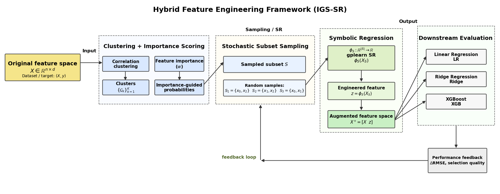
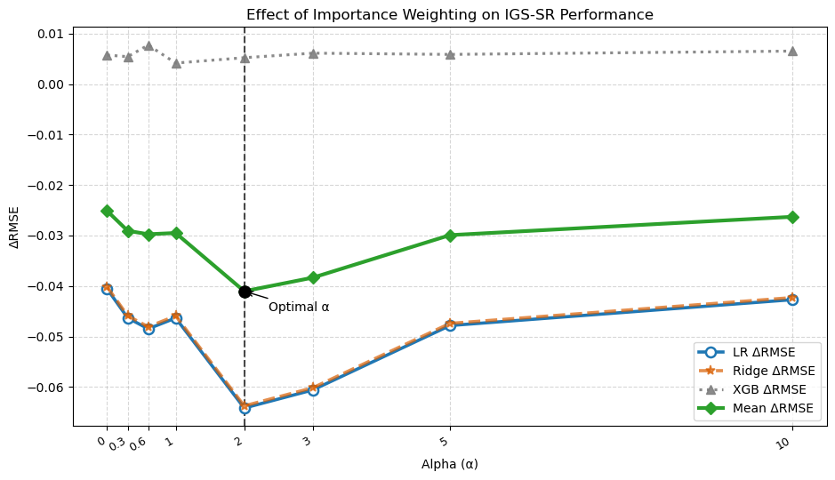
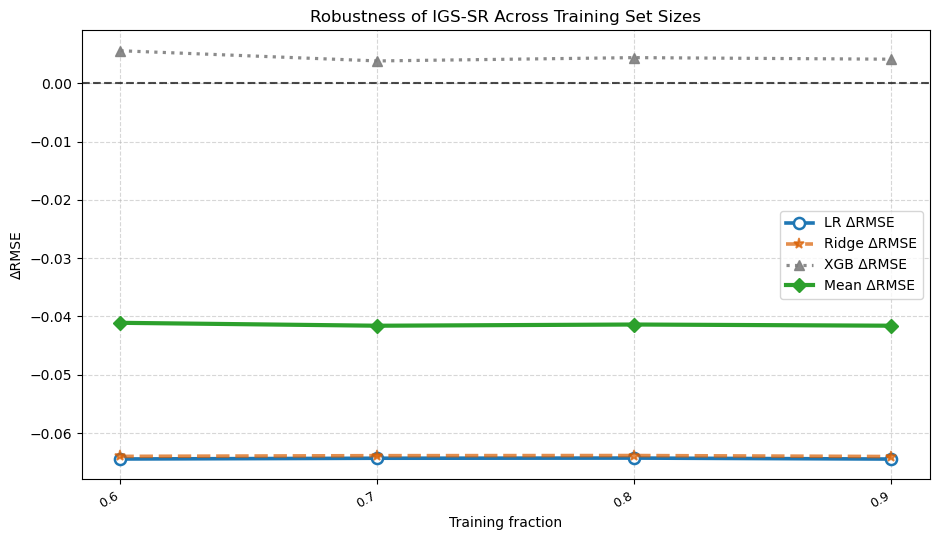

# Importance-Guided Stochastic Symbolic Regression for Scalable Feature Engineering

**M.S. Thesis, Arizona State University (May 2026)** · Raja Muhammad Shayan
Committee: Yanjie Fu (Chair), Hua Wei, Jin Wang · [Published on ProQuest](https://www.proquest.com/docview/3335804853)

This repository contains the research code, notebooks, processed datasets, and experiment results for my master's thesis. The thesis proposes **IGS-SR (Importance-Guided Stochastic Cluster Sampling Symbolic Regression)**, a way to use symbolic regression as an automated, interpretable feature-engineering step that costs far less compute than training one symbolic model per feature cluster.



## The idea in one paragraph

Symbolic regression (SR) searches for an explicit mathematical formula that predicts the target. Instead of using that formula as the final model, IGS-SR appends it to the original data as **one new engineered feature**, then trains ordinary downstream models (Linear Regression, Ridge, XGBoost) on the augmented data. To keep SR tractable, features are first grouped into correlated clusters; one feature is sampled from each cluster, with probability weighted by its importance, and a **single** SR model is trained on that small subset.

## Three strategies studied

| | Strategy | How it works | Trade-off |
|---|---|---|---|
| 1 | **Cluster-wise SR** | Correlation-based agglomerative clustering into *K* groups; one SR model per cluster; all *K* features appended | Strongest gains on California Housing, but *K* SR models per run |
| 2 | **Stochastic Cluster Sampling** | Same clusters; sample one feature per cluster uniformly; one SR model | One SR model per run; random picks can miss informative features |
| 3 | **IGS-SR (proposed)** | Same clusters; sample one feature per cluster with probability *p<sub>j</sub>* ∝ *w<sub>j</sub><sup>α</sup>* (tree-based importance *w*); one SR model | One SR model per run, sampling steered toward informative features |

*α = 0* reduces IGS-SR to uniform sampling (Strategy 2); larger *α* favours important features more strongly. The thesis uses *α = 2.0*.

**Shared configuration:** gplearn `SymbolicRegressor`, function set {+, −, ×, ÷, sin, cos}, population 1,500, 100 generations, parsimony 0.001; 80/20 train/test split with seed 42; standardization fit on the training set only. Metric: **ΔRMSE = RMSE(augmented) − RMSE(baseline)**, so negative means the symbolic feature helped.

## Key results

All numbers below are reported exactly as in the approved thesis and trace to files or notebook outputs in this repository.

### California Housing: strategy comparison (thesis Table 5.1)

| Method | LR ΔRMSE | Ridge ΔRMSE | XGB ΔRMSE | Mean ΔRMSE | Runtime (s) |
|---|---:|---:|---:|---:|---:|
| Strategy 1: Cluster-wise SR | −0.09 | −0.09 | −0.01 | −0.06 | 687 |
| Strategy 2: Stochastic Sampling | −0.04 | −0.04 | 0.00 | −0.03 | 216 |
| **IGS-SR (proposed)** | **−0.064** | **−0.064** | **+0.005** | **−0.041** | **179** |

- IGS-SR's −0.064 is about an **8.6% RMSE reduction** for Linear and Ridge regression (baseline RMSE ≈ 0.746). The IGS-SR row is the best observed run from the α = 2.0 ablation (10 runs; best selected by test RMSE, as described in thesis §5.2).
- Strategy 1 and 2 rows and all runtimes come from single seed-42 runs in [`all_strategies_runtime_comparison.ipynb`](notebooks/all_strategies_runtime_comparison.ipynb), measured on one CPU core of ASU's Sol cluster. Runtimes depend on hardware and settings.
- XGBoost barely changes: it already models the nonlinear structure the symbolic feature adds.

### Effect of importance weighting α (thesis Table 5.2, Figure 5.1)



| α | Best LR ΔRMSE | Best Ridge ΔRMSE | Mean ΔRMSE |
|---:|---:|---:|---:|
| 0.0 | −0.0406 | −0.0405 | −0.0251 |
| 0.3 | −0.0463 | −0.0463 | −0.0291 |
| 0.6 | −0.0485 | −0.0485 | −0.0297 |
| 1.0 | −0.0463 | −0.0463 | −0.0295 |
| **2.0** | **−0.0642** | **−0.0641** | **−0.0410** |

Values are the best observed run per α. Beyond α = 2.0 the gain shrinks (mean ΔRMSE −0.038 at α = 3, −0.030 at α = 5, −0.026 at α = 10), consistent with sampling concentrating on too few features.

### Benchmark across 11 public datasets (thesis Table 4.2)

| Dataset | n<sub>train</sub> | Features | LR ΔRMSE | Ridge ΔRMSE | XGB ΔRMSE | Mean ΔRMSE |
|---|---:|---:|---:|---:|---:|---:|
| Airfoil | 1,202 | 5 | −0.1082 | −0.1086 | 0.0184 | −0.0661 |
| Housing Boston | 404 | 13 | −0.4179 | −0.418 | 0.7718 | −0.0214 |
| OpenML-586 | 800 | 25 | −0.3139 | −0.3137 | −0.0124 | −0.2133 |
| OpenML-589 | 800 | 25 | −0.3296 | −0.3292 | 0.0237 | −0.2117 |
| OpenML-607 | 800 | 50 | −0.2571 | −0.257 | 0.0404 | −0.1579 |
| OpenML-616 | 400 | 50 | −0.2801 | −0.2807 | −0.0075 | −0.1895 |
| OpenML-618 | 800 | 50 | −0.3218 | −0.3221 | 0.0166 | −0.2091 |
| OpenML-620 | 800 | 25 | −0.3097 | −0.3095 | 0.016 | −0.2011 |
| OpenML-637 | 400 | 50 | −0.3005 | −0.3009 | −0.0108 | −0.2041 |
| Wine (Red) | 1,279 | 11 | −0.0002 | −0.0002 | 0.0011 | 0.0002 |
| Wine (White) | 3,918 | 11 | −0.0037 | −0.0037 | −0.001 | −0.0028 |

The symbolic feature lowers Linear and Ridge RMSE on all 11 datasets, with the largest gains on the OpenML regression benchmarks and negligible change on the two wine datasets. Effects on XGBoost are small in most cases; Boston Housing is the exception, where XGB RMSE rises by 0.77. For each dataset, 40 IGS-SR runs were made at α = 2.0 and the best run (by SR test RMSE) was evaluated. Per-dataset files: [`results/experiments/`](results/experiments/).

### Robustness (thesis §5.3)



With the α = 2.0 symbolic feature held fixed, retraining the downstream models on 60–90% of the training data kept mean ΔRMSE between about −0.039 and −0.044 (5 seeds per fraction).

### Interpretability

The best California Housing feature is an explicit expression in three variables, **AveOccup**, **Latitude**, and **MedInc**, combining income, household occupancy, and location through arithmetic and trigonometric terms (thesis Eq. 5.1). The same three-variable subset was repeatedly selected across runs (thesis §5.3).

## Repository structure

```
.
├── notebooks/
│   ├── all_strategies_runtime_comparison.ipynb   # Strategy 1 vs 2 vs IGS-SR on California Housing, with timing (Table 5.1)
│   ├── hybrid_strategy_implementation.ipynb      # IGS-SR development, α ablation, robustness tests, figures (Tables 5.2–5.3)
│   ├── Experiments_new.ipynb                     # 11-dataset benchmark and aggregation (Tables 4.1–4.2)
│   └── strategy2_rerun.ipynb                     # Earlier implementation phase (see terminology note)
├── data/
│   ├── README.md                                 # Sources, licenses, preprocessing, Boston Housing note
│   └── canonical/<dataset>/                      # X_train/X_test.parquet (standardized), y_train/y_test.pkl, meta.json
├── results/
│   ├── experiments/                              # <dataset>_evaluation_summary.{json,csv}, <dataset>_sweep_partial.csv
│   └── figures/                                  # Thesis figures 3.1, 5.1, 5.2 (exported from notebook outputs)
├── requirements.txt
├── CITATION.cff
└── LICENSE
```

**Terminology note.** `strategy2_rerun.ipynb` predates the final thesis naming. What it calls "Strategy 2" (one SR model per correlation cluster, K = 3–6) corresponds to the thesis's **Strategy 1: Cluster-wise SR**. Its "Strategy 1" section is an earlier grouping approach (farthest-subset clusters) that was not carried into the thesis. All other notebooks use the final names.

## Running the notebooks

The notebooks are published exactly as they were run for the thesis, on ASU's Sol HPC cluster (128-core nodes, SLURM). Their saved outputs are the record of the results. To re-run them:

```bash
git clone https://github.com/shayanraja123/importance-guided-symbolic-regression.git
cd importance-guided-symbolic-regression
python -m venv .venv && source .venv/bin/activate
pip install -r requirements.txt

# The notebooks read data from artifacts/canonical/<dataset>/
mkdir -p artifacts && ln -s ../data/canonical artifacts/canonical
jupyter lab
```

Things to know before re-running:

- Each SR fit (population 1,500 × 100 generations) takes about 3 minutes on one core; the 11-dataset benchmark runs 40 fits per dataset, so plan for hours, not minutes.
- Some cells depend on variables created by earlier cells or saved in `artifacts/` by earlier runs, and a few plotting cells save to absolute paths from the cluster. Adjust those paths for your machine.
- `fetch_california_housing` downloads data from the internet on first use.

## Environment

Python 3.12.9 with numpy 1.26.4, pandas 2.3.3, scikit-learn 1.2.2, gplearn 0.4.2, xgboost 2.1.1, joblib 1.5.3, pyarrow 22.0.0 (pinned in [`requirements.txt`](requirements.txt)). Newer scikit-learn releases may not be compatible with gplearn 0.4.2, so keep the pinned versions together.

## Citation

If you use this work, please cite the thesis:

```bibtex
@mastersthesis{shayan2026igssr,
  author  = {Raja Muhammad Shayan},
  title   = {Importance-Guided Stochastic Symbolic Regression for Scalable Feature Engineering},
  school  = {Arizona State University},
  year    = {2026},
  month   = {May},
  type    = {M.S. Thesis},
  url     = {https://www.proquest.com/docview/3335804853}
}
```

## Acknowledgements

Thanks to my thesis chair, Prof. Yanjie Fu, and committee members Prof. Hua Wei and Prof. Jin Wang. Experiments were run on ASU Research Computing's Sol supercomputer. The work builds on [gplearn](https://github.com/trevorstephens/gplearn), [scikit-learn](https://scikit-learn.org), and [XGBoost](https://xgboost.ai). Baseline methods in thesis Table 4.1 are as reported in Wang et al., *Group-wise Reinforcement Feature Generation for Optimal and Explainable Representation Space Reconstruction*, KDD 2022 ([arXiv:2205.14526](https://arxiv.org/abs/2205.14526)).

## License

Code in this repository is released under the [MIT License](LICENSE). The thesis itself is copyright of the author and is available through ProQuest. Datasets remain under their original licenses; see [`data/README.md`](data/README.md).
